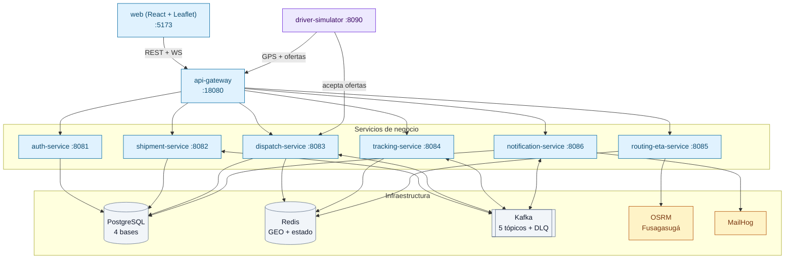
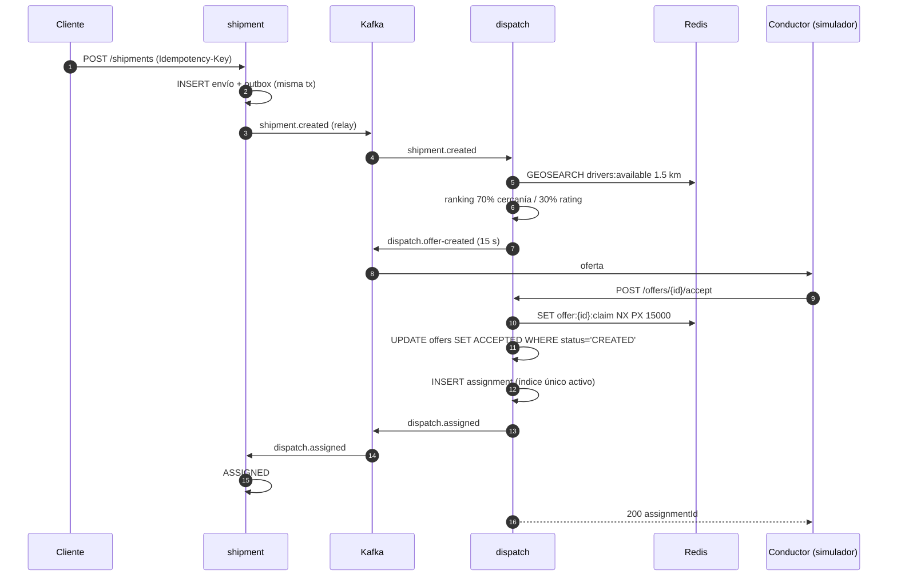
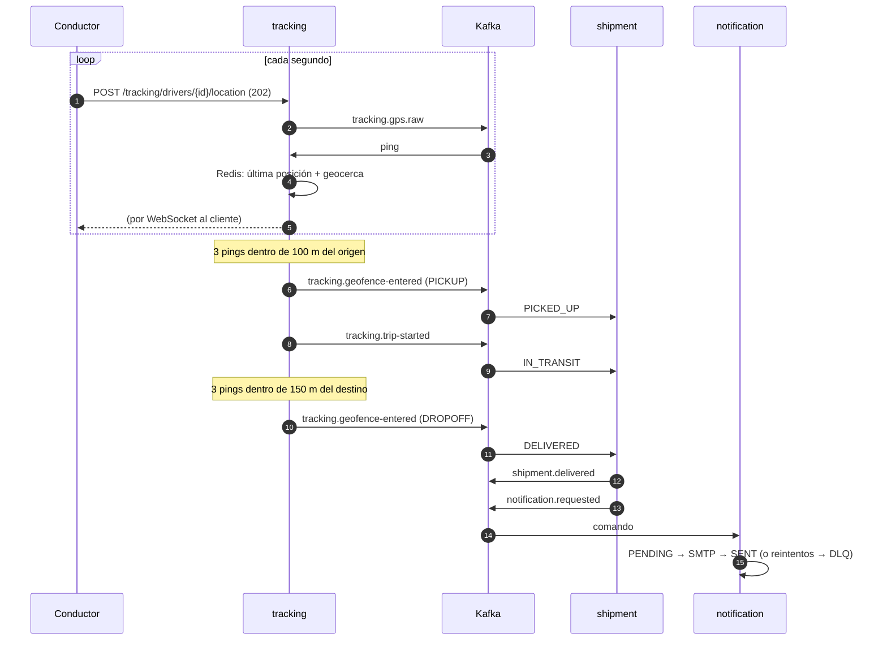

# Arquitectura (C4)

Diagramas en Mermaid: se renderizan directamente en GitHub y en el editor.

## Nivel 1 — Contexto

```mermaid
flowchart LR
    cliente[Cliente]:::person
    conductor[Conductor]:::person
    operador[Operador / Admin]:::person

    enruta[["EnRuta\n(plataforma de última milla)"]]:::system

    maps[OpenStreetMap\n(mapas)]:::external
    smtp[Servidor SMTP\n(MailHog en local)]:::external

    cliente -->|crea y sigue envíos| enruta
    conductor -->|recibe ofertas y reporta GPS| enruta
    operador -->|supervisa| enruta
    enruta -->|teselas y rutas| maps
    enruta -->|correos| smtp

    classDef person fill:#e2e8f0,stroke:#334155,color:#0f172a
    classDef system fill:#38bdf8,stroke:#0369a1,color:#06283d
    classDef external fill:#f1f5f9,stroke:#94a3b8,color:#0f172a
```

## Nivel 2 — Contenedores



## Secuencia — asignación



## Secuencia — entrega


